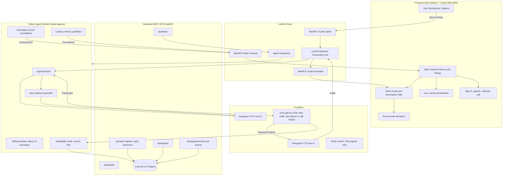
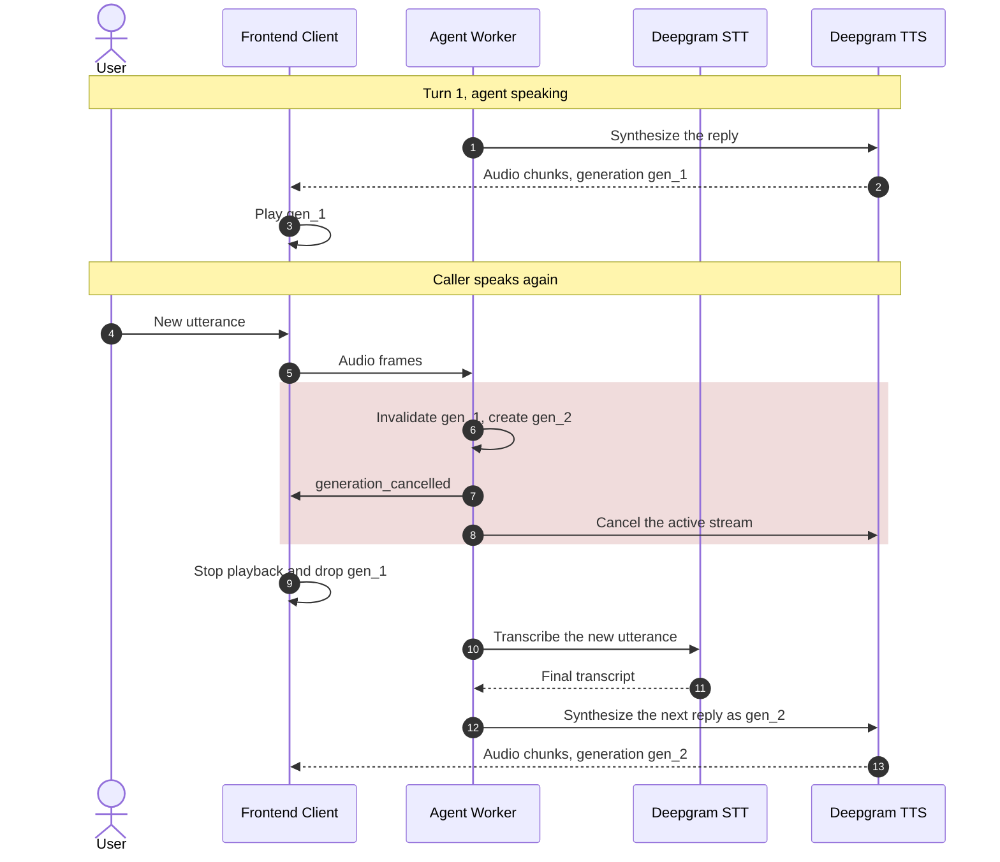

# Custom Voice Agent architecture

## 1. System overview and latency budget

Custom Voice Agent is a real-time voice assistant. The browser talks over WebRTC. A Python worker runs speech-to-text, the language model, and speech synthesis for one room. A FastAPI service issues LiveKit tokens, stores accounts and agents, and stores visits for agents that book appointments.

The design budget for one turn, from the end of speech to the first audio of the reply, is under 500ms. The pipeline does not meet that budget on the one turn that was measured. That turn took 933ms: the language model’s first token was 548ms and the first synthesized audio was 378ms. Speech-to-text reported 0ms because the transcript arrived before voice-activity detection marked the end of the clip, and a negative gap is clamped to zero.

```
+───────────────────────────────────────────────────────────────────────────────────────────+
|                                    LATENCY BUDGET WATERFALL                                |
+───────────────────────────────────────────────────────────────────────────────────────────+
| [0ms] User stops speaking                                                                 |
|   ├── [0-25ms] WebRTC Media Transport (Opus 48kHz audio frames via LiveKit SFU)           |
|   ├── [25-135ms] Deepgram STT (nova-3 streaming endpointing & final transcript)   (~110ms)|
|   ├── [135-136ms] Input Guardrails (<1ms fast memory classifier)                          |
|   ├── [136-320ms] Groq LLM (gpt-oss-20b streaming token TTFT)                     (~185ms)|
|   ├── [320-405ms] Deepgram TTS (aura-2-andromeda-en streaming TTFB)                (~85ms)|
|   └── [405-435ms] WebRTC Downlink & Local Audio Buffer Playback                    (~30ms)|
+───────────────────────────────────────────────────────────────────────────────────────────+
| DESIGN BUDGET: ~435ms (target under 500ms). One measured turn: 933ms.                     |
+───────────────────────────────────────────────────────────────────────────────────────────+
```

### 1.1 Ways to shorten a turn later

These are options, not behavior in the current worker:

1. **Speculative execution.** Send an early, unfinalized transcript to the model so token generation can start before the caller finishes.
2. **A turn-taking model.** Replace the silence threshold in voice-activity detection with a model that predicts the end of a turn.
3. **Same-region hosting.** Run the LiveKit SFU and the Python worker in the same region as Groq and Deepgram.

---

## 2. Core components



Room names look like `agent_{agent-uuid}_{8-char-suffix}`. The worker reads the agent id as the second underscore-separated piece. UUIDs use hyphens, so they stay one piece.

---

## 3. Components

### 3.1 Accounts and the REST API

Sign-in is email and a password. The password hash is PBKDF2-SHA256 with 200,000 iterations. The session token is a PyJWT HS256 token that expires in 14 days, signed with `SESSION_SECRET`. Routes that change agents, read the private calendar, or mint a LiveKit token require `Authorization: Bearer`.

`POST /api/auth/password` changes the password for the signed-in account. There is no email reset.

`/api/token` checks that the room’s agent belongs to the account, then reserves the room in `active_calls`. The worker refreshes that row every 20 seconds and releases it when the job shuts down. A second live call is refused while `MAX_ACTIVE_CALLS` is 1.

`/api/agents` stores the name, objective, system prompt, reference text, and a capabilities list. Reference text is cut at 12,000 characters. Uploads are PDF or TXT, up to 5MB. An agent with `appointments` in its capabilities gets the booking tools. Other agents may call Tavily web search, with a 4 second timeout.

`GET /api/appointments` is the signed-in hospital’s calendar. `GET /api/appointments/lookup` is public and needs both the confirmation id and the 10-digit phone. The lookup response includes the name, department, date, time label, and id. It does not include the phone.

`/api/health` reports whether provider credentials are present and whether the worker heartbeat file is fresh. `/api/frontend-logs` appends browser batches. Failures return a short message.

Rate limits are rows in `rate_hits`, keyed by bucket and client address. Auth is 8 requests per minute, agent writes 10, lookup 8, token 20, and frontend logs 30. The client address is the socket address. When `TRUST_PROXY` is true, it is the last `X-Forwarded-For` hop.

`audit_log` records register, login, password change, book, cancel, and lookup, with the account id and whether it succeeded. It does not store the phone.

### 3.2 Appointments

The schedule is code, not a retrieved document. Departments general medicine, skin, and pediatrics share one grid: Monday through Saturday, 09:00 through 16:30, 16 slots of 30 minutes. Sunday is closed. The calendar shows the next open days. A slot today must start at least 15 minutes from now.

`book` writes one row. The unique key is owner, department, date, and time, so two hospitals can both have 11:00 and one hospital cannot book that slot twice. The phone must be exactly 10 digits. It is stored with Fernet. The key is the URL-safe SHA-256 of `SESSION_SECRET`. Cancel and “find my visit” on the call also require that phone and the confirmation id.

A visit row holds:

| Field | Meaning |
| :--- | :--- |
| `id` | 8 hex characters, spoken as the confirmation number |
| `owner_id` | Hospital account |
| `hospital` | Hospital name at booking time |
| `patient_name` | Name collected on the call |
| `phone` | Encrypted 10-digit number |
| `department` | General medicine, skin, or pediatrics |
| `date` | `YYYY-MM-DD` |
| `time` | `HH:MM`, spoken as a 12-hour time |

The first account to register claims the seeded demo agents and any visits whose `owner_id` is null. This runs in production too, so a fresh production account can use the City Hospital booking agent. Later accounts cannot claim unowned rows.

### 3.3 WebRTC and the data channel

Audio is a full-duplex WebRTC track. LiveKit carries Opus, a jitter buffer, and NAT traversal.

The reliable data channel carries JSON:

1. `turn_metrics` with `stt_ms`, `llm_ttft_ms`, `tts_ttfb_ms`, and `e2e_ms`.
2. `generation_cancelled` so the page drops stale audio and interim text.
3. `interim_transcript` and `final_transcript`.
4. `pipeline_health` from the worker.

Control messages include a monotonic `seq`. The page drops a message whose sequence is less than or equal to the last one it accepted.

### 3.4 Worker

`start.sh` runs one Gunicorn worker for the API and restarts `agent_worker.py` if it exits. Gunicorn is the Linux deploy path. Local Windows runs `python main.py` and `python agent_worker.py start` as two processes. Both must use the same `DATA_DIR`.

The worker loads the agent for the room, then builds tools from `capabilities`. Booking tools call the same appointment functions the API uses, with that agent’s `owner_id`.

Conversation memory keeps the safety prompt and the latest 10 messages. Truncation copies the chat context, truncates the copy, and applies it with the SDK update method.

The LiveKit Agents SDK buffers model tokens to a phrase boundary before each Deepgram synthesis request, so the first sentence can start playback before the full reply exists.

### 3.5 Language models

The worker tries models in order: `openai/gpt-oss-20b`, then `openai/gpt-oss-120b`, then `llama-3.1-8b-instant`, all through Groq’s OpenAI-compatible endpoint. The two `gpt-oss` models share one tokens-per-minute limit and one daily token cap. When every model fails, the worker says “One moment. Please say that again.” and does not pretend a tool succeeded. The third model id has to exist on the Groq account in use. A 404 there leaves no backup once the daily cap is spent.

---

## 4. Ghost audio and barge-in

Ghost audio is leftover playback from turn N after the caller starts turn N+1.



Every spoken response is stamped `gen_{turn}_{uuid}`. When the user state becomes `speaking`, the worker sends `generation_cancelled`. The page keeps a set of cancelled ids and drops matching audio and interim text.

A turn that is split into several transcripts still reaches the model as several user messages. A phone number spoken as separate bursts can be counted short until a later burst completes it. The booking function rejects anything other than 10 digits, so a partial number is not saved.

---

## 5. Failure behavior

| Subsystem | What goes wrong | What the product does |
| :--- | :--- | :--- |
| Microphone | Permission denied or the device leaves | The call UI marks the mic muted and logs the error. |
| WebRTC | ICE failure or disconnect | The session ends. LiveKit restarts ICE on its own while the room is up. |
| Speech-to-text | Deepgram timeout or a rate limit | The worker broadcasts `pipeline_error`. The page shows a banner. |
| Language model | Primary Groq model fails | The worker tries `gpt-oss-120b`, then `llama-3.1-8b-instant`. If all three fail, it asks the caller to repeat. |
| Slow speech synthesis | No audio for 2.5 seconds while the page is in `thinking` | A backpressure warning. The transcript still shows. |
| Data messages | Duplicate or reordered packets | Drop `seq` at or below the last accepted value. |
| Duplicate audio | The same payload arrives twice | WebRTC RTP sequence numbers drop it before playback. |
| Empty speech | Transcript shorter than 2 characters | The turn is dropped. The model is not called. |
| Bad agent write | Invalid create or update | HTTP 400 with a short JSON error. |
| Web search | Tavily exceeds 4 seconds | The tool returns that search timed out. Booking agents do not have this tool. |
| Slot race | Two bookings take one slot | The unique index rejects the second write. The tool says the time was just taken. |
| Second live call | Another token while a room is held | HTTP 409. The desk is already on a call. |
| Confirmation lookup | Wrong phone or unknown id | The same short “no match” response, so the form does not reveal which field failed. |

---

## 6. Technology choices

| Technology | Role | Why it is here |
| :--- | :--- | :--- |
| WebRTC (LiveKit) | Full-duplex audio | Opus, NAT traversal, and a jitter buffer on one session. |
| FastAPI | Accounts, agents, tokens, visits | Fits the LiveKit Agents worker, which is Python. |
| LiveKit data channel | Metrics, cancellation, transcripts | Ordered control messages beside the audio, without a second socket. |
| Process memory | The live conversation | One session lives in one worker. The durable facts are in the database. |
| SQLite `vocal.db` | Local accounts, agents, visits, rate limits, audit, active calls | One file in `DATA_DIR`. WAL and a 5 second busy timeout. |
| Postgres | Same schema when `DATABASE_URL` starts with `postgres` | For a split API and worker, or a host whose disk does not survive the way you need. This branch is implemented and has not been executed against a server in this repo. |
| Fernet | Phone numbers at rest | Ciphertext in the phone column. The key is derived from `SESSION_SECRET`. |

JSON files (`agents.json`, `appointments.json`) are imported once when the matching table is empty. They are not the live store.

---

## 7. What is kept, and where

- **Live call.** `AgentSession` holds the recent turns and the clocks for the current room. `active_calls` holds the room name so a second call can be refused after a process restart, until the row is stale.
- **Durable rows.** `accounts`, `agents`, `appointments`, `rate_hits`, `audit_log`, and `active_calls` live in `DATA_DIR/vocal.db`, or in Postgres when `DATABASE_URL` is set.
- **Browser.** The login token is `vocal_token` in `localStorage`. The page polls the signed-in calendar every 4 seconds. A 401 clears the token.
- **Render.** `DATA_DIR=/var/data` on a 1GB disk. `SESSION_SECRET` is generated for the service. `TRUST_PROXY=true`. One API worker and one voice worker share that disk’s SQLite file. A running call ends when the process restarts.
